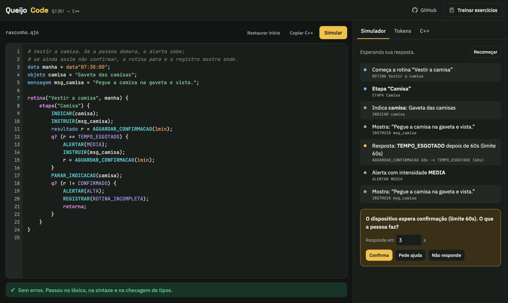
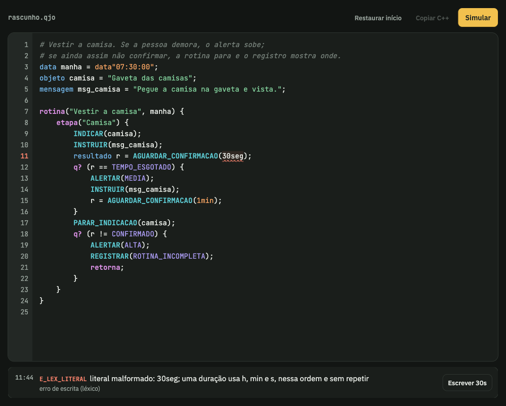
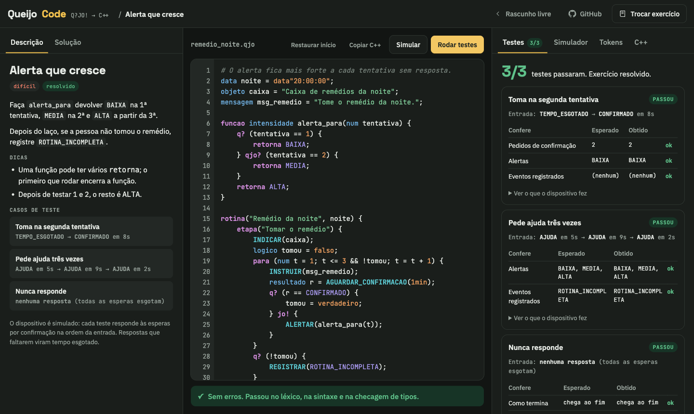

# Q?JO!

**Uma linguagem para programar rotinas que guiam pessoas com dificuldades cognitivas, um passo de cada vez.**

**Experimente no navegador:** [qjo.daviduarte.com.br](https://qjo.daviduarte.com.br)



---

## Por que esse projeto existe

Depois de um traumatismo craniano, ou num quadro de demência, muita gente continua capaz de
fazer cada movimento de uma tarefa, mas se perde na sequência. Pegar a roupa, vestir, tomar o
remédio na hora certa: cada passo é possível, a ordem é que escapa. O resultado é depender de
alguém para lembrar de tudo, mesmo tendo corpo para fazer sozinho, enquanto o terapeuta
ocupacional, no SUS, costuma ver o paciente uma vez por semana.

No Módulo 8 de Ciência da Computação do [Inteli](https://inteli.edu.br), a turma trabalha
com o curso de Terapia Ocupacional da **Faculdade de Medicina da USP (FMUSP)**, junto ao Grupo
de Pesquisa Interdisciplinar em Reabilitação e Tecnologias Assistivas, num dispositivo para
esse problema:

- Sinalizadores com **luz e som** ficam presos nos objetos da rotina: a gaveta das camisas, a
  caixa de remédios.
- O dispositivo **indica** onde está o próximo objeto, **diz** o que fazer e **espera** a pessoa
  confirmar num botão.
- Se ela demora, o alerta cresce. Se mesmo assim a etapa não acontece, o que houve fica
  **registrado** para o terapeuta ver na visita seguinte.

Quem decide a rotina é o terapeuta, porque cada paciente precisa de etapas, tempos e
insistências diferentes. **Q?JO!** (lê-se "queijo") é a linguagem que a turma criou para ele
escrever essas rotinas, e o compilador traduz cada uma para o programa que roda no dispositivo.

Este repositório é um projeto pessoal. Escrevi o compilador da Q?JO! do zero em Rust e
construí em volta dele o que eu queria ter: um site para escrever e testar rotinas sem
instalar nada, suporte nos editores, a especificação completa e testes que seguram tudo isso.
O dispositivo físico é do projeto do grupo e não está aqui. Os exemplos usam só dados
fictícios, nenhum vem de paciente real.

## Como é uma rotina

```qjo
data manha = data"07:30:00";
objeto camisa = "Gaveta das camisas";
mensagem msg_camisa = "Pegue a camisa na gaveta e vista.";

rotina("Vestir a camisa", manha) {
    etapa("Camisa") {
        INDICAR(camisa);
        INSTRUIR(msg_camisa);
        resultado r = AGUARDAR_CONFIRMACAO(1min);
        q? (r == TEMPO_ESGOTADO) {
            ALERTAR(MEDIA);
            INSTRUIR(msg_camisa);
            r = AGUARDAR_CONFIRMACAO(1min);
        }
        PARAR_INDICACAO(camisa);
        q? (r != CONFIRMADO) {
            ALERTAR(ALTA);
            REGISTRAR(ROTINA_INCOMPLETA);
            retorna;
        }
    }
}
```

`q?` é *se*, `qjo?` é *senão se* e `jo!` é *senão*. Se a pessoa não responde nenhuma das duas
vezes, o registro que o terapeuta recebe é este:

```text
$ qjo run vestir.qjo -r "TEMPO_ESGOTADO, TEMPO_ESGOTADO"
ROTINA Vestir a camisa
ETAPA Camisa
INDICAR camisa
INSTRUIR msg_camisa
AGUARDAR_CONFIRMACAO 60s -> TEMPO_ESGOTADO (60s)
ALERTAR MEDIA
INSTRUIR msg_camisa
AGUARDAR_CONFIRMACAO 60s -> TEMPO_ESGOTADO (60s)
PARAR_INDICACAO camisa
ALERTAR ALTA
REGISTRAR ROTINA_INCOMPLETA
FIM cancelada
```

Também há laços, funções, enums próprios, datas e durações. A linguagem inteira está em
[`spec/`](spec/), e há mais rotinas em [`examples/`](examples/).

## Experimente

### No navegador

**[qjo.daviduarte.com.br](https://qjo.daviduarte.com.br)**: sem cadastro e sem instalar nada.
O compilador roda na própria página, em WebAssembly.

- **Erros enquanto você digita**, com a linha, o motivo e um botão que aplica a correção.
- **Simulador**: você faz o papel da pessoa e responde cada espera (confirma, pede ajuda ou
  não responde) para ver o que o dispositivo faria.
- **Exercícios** do fácil ao difícil, com casos de teste e solução escondida.
- **Tokens** e o **C++** gerado, para quem quer ver como o compilador funciona.

<table>
  <tr>
    <td width="50%"></td>
    <td width="50%"></td>
  </tr>
  <tr>
    <td align="center">Erro com a correção pronta</td>
    <td align="center">Exercício com os testes passando</td>
  </tr>
</table>

### No terminal

Precisa do [Rust](https://rustup.rs).

```sh
cargo install --git https://github.com/Yuhtin/qjo qjo-cli qjo-lsp

qjo check rotina.qjo                      # erros com linha, coluna e sugestão
qjo run rotina.qjo                        # simulador: você responde cada espera no terminal
qjo run rotina.qjo -r "CONFIRMADO 3, AJUDA 5"
qjo build rotina.qjo --exe                # gera rotina.cpp e compila com o C++ do sistema
qjo fmt rotina.qjo
```

```text
erro[E_LEX_LITERAL]: literal malformado: 30seg; uma duração usa h, min e s, nessa ordem e sem repetir
 --> rotina.qjo:9:44
  |
9 |         resultado r = AGUARDAR_CONFIRMACAO(30seg);
  |                                            ^^^^^
  = sugestão: Escrever 30s

1 erro de léxico em rotina.qjo
```

### No editor

A extensão para VS Code e Cursor sai em cada [release](https://github.com/Yuhtin/qjo/releases),
um `.vsix` por plataforma (Extensions → Install from VSIX). Ela traz erros com correção rápida,
autocompletar, ir para a definição, formatar ao salvar e o simulador no terminal
([detalhes](editors/vscode/README.md)). Para Zed, Neovim ou Helix, aponte o editor para o
`qjo-lsp` em arquivos `.qjo`.

## O que tem aqui

| Pasta | O que é |
| --- | --- |
| [`spec/`](spec/) | A especificação: léxico, sintaxe, semântica, execução e C++. Ela manda no código. |
| [`crates/qjo-core`](crates/qjo-core) | Léxico, sintaxe (com recuperação de erros), semântica, interpretador, gerador de C++17 e formatador. Sem dependências. |
| [`crates/qjo-cli`](crates/qjo-cli) | O comando `qjo`: `check`, `run`, `build`, `tokens`, `fmt`. |
| [`crates/qjo-lsp`](crates/qjo-lsp) | Servidor de linguagem para VS Code, Cursor, Zed, Neovim, Helix e qualquer editor com LSP. |
| [`crates/qjo-wasm`](crates/qjo-wasm) | O núcleo compilado para WebAssembly (206 KB, sem wasm-bindgen). |
| [`web/`](web/) | O site: editor, simulador, exercícios e C++ ([como rodar e publicar](web/README.md)). |
| [`editors/vscode`](editors/vscode) | Extensão para VS Code e Cursor, que leva o `qjo-lsp` e o `qjo` dentro. |
| [`tests/conformance`](tests/conformance) | Programas `.qjo` com a saída esperada. Todas as implementações passam por eles. |
| [`examples/`](examples/) | Rotinas de exemplo. |
| [`bench/`](bench/) | Programas e medidor de desempenho. |

```text
                                        ┌─▶ interpretador ─▶ simulador (terminal, site, VS Code)
.qjo ─▶ léxico ─▶ sintaxe ─▶ semântica ─┤
                                        └─▶ gerador de C++17 ─▶ programa do dispositivo
```

## Como os testes seguram o comportamento

- `tests/conformance` tem 56 casos, cada um conferindo uma regra da spec: posições do léxico,
  recuperação de erros de sintaxe, cada erro semântico e cada caso de execução.
- O C++ gerado é compilado com `-Wall -Wextra -Werror` e precisa imprimir exatamente o
  mesmo que o interpretador, com o mesmo código de saída.
- O servidor de linguagem é testado conversando com o binário por JSON-RPC, e a extensão
  dentro de um VS Code de verdade.

```sh
cargo test --all                          # núcleo, conformidade, C++ e LSP
QJO_ATUALIZAR=1 cargo test -p qjo-core --test conformidade   # reescreve os esperados
```

## Desempenho

Comparado com a primeira implementação, em JavaScript (Node 22), nas mesmas entradas; mediana
de 30 rodadas num Mac com Apple Silicon. A análise inclui léxico, sintaxe e semântica.

| Medida | JavaScript | Rust | |
| --- | --- | --- | --- |
| Análise, 900 linhas (200 rodadas) | 0,79 ms | 0,27 ms | 2,9× |
| Análise, 9 mil linhas | 9,6 ms | 2,6 ms | 3,7× |
| Análise, 90 mil linhas | 104 ms | 32,5 ms | 3,2× |
| Execução, 150 mil voltas de laço com chamada | 517 ms | 21,2 ms | 24× |

Como medir: [`bench/README.md`](bench/README.md).

## Próximos passos

- Gramática tree-sitter para cores nativas no Zed, Neovim e Helix.
- Publicar a extensão no Marketplace do VS Code e no Open VSX (o Cursor busca de lá).
- Pedir a entrada da linguagem no Linguist, para o GitHub colorir arquivos `.qjo`.
- Compilar para bytecode, se algum dia as rotinas ficarem grandes o bastante para importar.

## Licença

[MIT](LICENSE).
