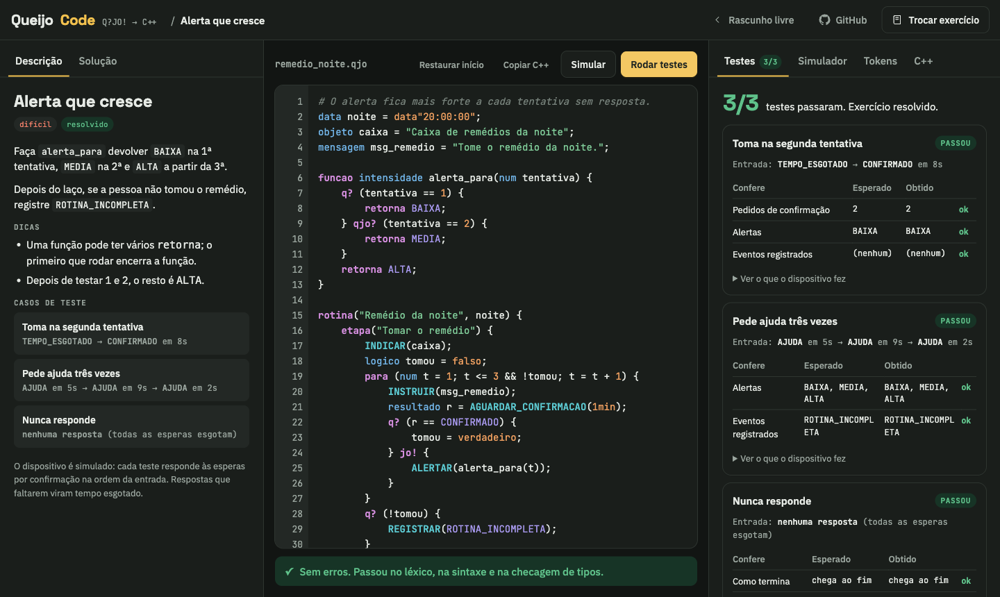

# QueijoCode

**No ar:** [qjo.daviduarte.com.br](https://qjo.daviduarte.com.br)

Editor, simulador, exercícios e gerador de C++ da Q?JO! no navegador. Vite + TypeScript +
CodeMirror 6. O compilador é o próprio `qjo-core`, compilado para WebAssembly (`crates/qjo-wasm`).



O visual é o da QueijoCode original: o mesmo layout, as mesmas cores e
os mesmos componentes, copiados em `src/estilo.css`. Só o editor mudou por dentro: é o
CodeMirror com o desenho do editor antigo, o que traz autocompletar, dica ao passar o mouse e
ir à definição (Cmd/Ctrl+clique ou F12). Shift+Alt+F formata.

## Rodar localmente

Precisa de Node 20+ e do Rust com o alvo `wasm32-unknown-unknown`
(`rustup target add wasm32-unknown-unknown`).

```sh
cd web
npm install
npm run dev
```

`npm run dev` e `npm run build` compilam o WASM antes (`scripts/wasm.sh`) e copiam para
`public/qjo.wasm`, que não vai para o git. Sem `cargo` no PATH, o script usa o
`public/qjo.wasm` que já existir.

Os exercícios estão em `src/exercicios.ts`. Cada caso confere o que a rotina fez (como termina,
eventos, alertas, esperas...), medido a partir do registro do interpretador.

## Deploy

A máquina de build da Vercel não tem Rust, então o build é feito aqui e só o resultado sobe
(`vercel build` + `vercel deploy --prebuilt`). O projeto na Vercel é `qjo-web`, no time
`bitsbrs-projects`, e a produção responde em https://qjo.daviduarte.com.br.

Na primeira vez, ligue a pasta ao projeto:

```sh
cd web
npx --yes vercel@latest link --yes --project qjo-web --scope bitsbrs-projects
npx --yes vercel@latest pull --yes --environment=preview
```

Depois, para cada deploy de prévia:

```sh
npm run deploy
```

O script passa `--environment preview` de propósito: num projeto sem Git conectado, o
`vercel deploy` sem esse parâmetro publica em produção. Para publicar em produção
(qjo.daviduarte.com.br):

```sh
npm run deploy:prod
```

O `vercel.json` aponta `buildCommand` para `npm run build` e a saída para `dist/`.
